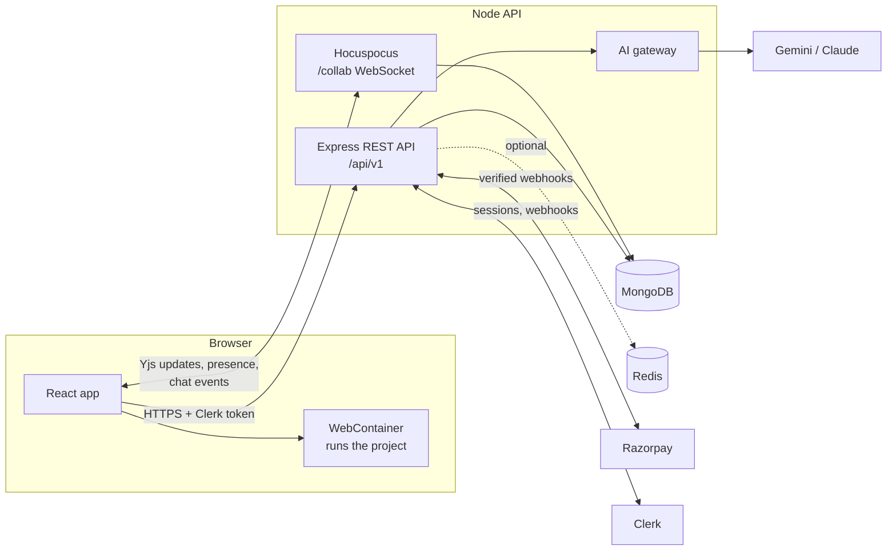

# CodeCollab

**A shared code workspace for small teams.** Open a project, edit the same files together with live cursors, run the app right in the browser, talk it through in a chat that keeps its history, and bring in an AI pair-programmer whose suggestions everyone can see and nobody has to accept blindly.

<picture>
  <source media="(prefers-color-scheme: dark)" srcset="docs/screenshots/landing-dark.png" />
  
</picture>

---

## Contents

- [Features](#features)
- [How it fits together](#how-it-fits-together)
- [Tech stack](#tech-stack)
- [Getting started](#getting-started)
- [Configuration](#configuration)
- [Project structure](#project-structure)
- [Under the hood](#under-the-hood)
- [Testing and quality](#testing-and-quality)
- [Deployment](#deployment)
- [Demo video](#demo-video)
- [Contributing](#contributing)

## Features

### A workspace that feels like a desktop editor

- **File explorer modelled on VS Code.** Create files and folders with an inline name box inside the folder you picked, rename in place with <kbd>F2</kbd>, and move anything by dragging it onto a folder (or onto empty space for the top level). Folders open as you hover over them while dragging, invalid drops are refused, and moves show up instantly.
- **Right-click menus and keyboard control.** Every action is in a context menu, and the tree works entirely from the keyboard: arrows to move, <kbd>→</kbd>/<kbd>←</kbd> to open and close folders, <kbd>Home</kbd>/<kbd>End</kbd>, <kbd>F2</kbd> to rename and <kbd>Del</kbd> to delete.
- **CodeMirror editor** with syntax highlighting for common languages, tabs that are remembered per project, and light and dark themes.

### Real-time collaboration

- **Edit together without conflicts.** Each file is a [Yjs](https://yjs.dev) document, so several people can type in the same file at once and every edit merges cleanly.
- **See who is where.** Live cursors and selections in the editor, and coloured dots in the file tree showing who has each file open.
- **Changes are saved for you** a couple of seconds after typing stops.

### Run it in the browser

- **No server-side sandboxes.** Projects run inside [WebContainer](https://webcontainers.io) (Node.js in the browser) on each person's own machine: `npm install` and a dev server with live preview, a static site, or a plain Node script, depending on what the project contains.

### Team chat that remembers

- **Persistent project chat** with threads, reactions, `@mentions`, typing indicators and unread counts.

### An AI pair-programmer the whole team can see

- **Mention `@ai` in chat.** The answer streams to everyone in the project.
- **Changes arrive as a diff, not a surprise.** Code changes are proposed as a reviewable diff that an editor accepts or dismisses. Accepted changes flow through the live documents, so every open editor updates at once.
- **Several providers with automatic fallback** (Gemini, and optionally Claude), with per-plan quotas, rate limits and a daily spending ceiling.

### Teams, roles and plans

- **Owner, editor and viewer roles.** Invite people with shareable links. Viewers can read and follow along but can't change files or ask the AI.
- **Free and Pro plans.** Limits come from a single definition in `shared/src/plans.ts` and are enforced by the API:

  |                         | Free        | Pro                           |
  | ----------------------- | ----------- | ----------------------------- |
  | Projects you own        | 3           | Unlimited                     |
  | Collaborators / project | 2           | 10                            |
  | AI requests             | 30 per day  | 1,500 per month               |
  | AI models               | Fast models | Fast and premium models       |
  | Price                   | Free        | ₹799 / month or ₹7,990 / year |

- **Payments through Razorpay** (test mode). Pro is a prepaid pass with nothing to cancel, and the plan changes only after Razorpay confirms the payment.

<picture>
  <source media="(prefers-color-scheme: dark)" srcset="docs/screenshots/pricing-dark.png" />
  
</picture>

## How it fits together



- **The REST API** handles projects, members, files, chat, AI requests and billing. Every request is authenticated with a Clerk session token and validated with shared Zod schemas.
- **The collaboration server** runs on the same process. Each file is a Yjs document, and each project has its own document that carries presence (who is here, what they are looking at, who is typing) and broadcasts events such as "files changed" or "new chat message".
- **The browser** does the heavy lifting for running code, so the server never executes user projects.

## Tech stack

| Area     | Technology                                                                                   |
| -------- | -------------------------------------------------------------------------------------------- |
| Frontend | React 19, Vite, TanStack Router and Query, Tailwind CSS v4, Radix UI, CodeMirror 6, xterm.js |
| Realtime | Yjs, Hocuspocus, y-codemirror                                                                |
| Backend  | Node 22+, Express 5, Mongoose (MongoDB), ioredis (optional), pino, Zod                       |
| Auth     | Clerk (email and password, Google)                                                           |
| AI       | Official Gemini and Anthropic SDKs behind a small provider layer                             |
| Payments | Razorpay Payment Links and webhooks                                                          |
| Running  | WebContainer API                                                                             |
| Tooling  | TypeScript everywhere, npm workspaces, Vitest, ESLint, Prettier, GitHub Actions              |

## Getting started

### Prerequisites

- Node.js 22 or newer
- A MongoDB database: local, Docker, or a free [Atlas](https://www.mongodb.com/atlas) cluster
- A free [Clerk](https://clerk.com) application. In the dashboard, enable **Email + password** and **Google** under _User & authentication_.
- Optional: a free [Gemini API key](https://aistudio.google.com/apikey) for the AI assistant, and [Razorpay](https://razorpay.com) test keys for payments

### Run locally

```bash
npm install

cp backend/.env.example backend/.env     # MONGO_URI and the Clerk keys
cp frontend/.env.example frontend/.env   # VITE_CLERK_PUBLISHABLE_KEY

npm run dev
```

The API starts on <http://localhost:3000> and the web app on <http://localhost:5173>. Sign up, create a project from the starter template, and you're in the workspace.

> Users are created on their first API request, so the Clerk webhook (`POST /webhooks/clerk`, `user.*` events) is optional locally. In production it keeps profile changes and deletions in sync.

### Run with Docker

The whole stack (MongoDB, Redis, the API and the web app) starts with one command, which is useful for trying a production build or for running without Node and MongoDB installed.

```bash
cp .env.docker.example .env    # the two values the web image is built with
docker compose up --build      # web on http://localhost:8080, API on http://localhost:3000
```

| Image | Built from            | What it is                                                                 |
| ----- | --------------------- | -------------------------------------------------------------------------- |
| API   | `backend/Dockerfile`  | Node 22 Alpine, runs the bundled `dist/server.js` as a non-root user       |
| Web   | `frontend/Dockerfile` | nginx serving the built app, with the COOP/COEP headers WebContainer needs |

- **Secrets stay out of images.** API secrets (Clerk, Gemini, Razorpay) are read from `backend/.env` when the container starts. Compose overrides only `MONGO_URI`, `REDIS_URL` and `FRONTEND_URL` so they point at the containers.
- **The web image is tied to its build values.** Vite inlines `VITE_*` values at build time, so changing `VITE_API_URL` or the Clerk key means `docker compose build web`, not a restart.
- **Builds run from the repository root,** because the workspace needs the root lockfile and the `shared` package: `docker build -f backend/Dockerfile -t codecollab-api .`

### Scripts

All commands run from the repository root.

| Command                     | What it does                                                          |
| --------------------------- | --------------------------------------------------------------------- |
| `npm run dev`               | Start the API and the web app together                                |
| `npm run build`             | Production build of both apps                                         |
| `npm test`                  | Vitest suites for every workspace (the API uses an in-memory MongoDB) |
| `npm run lint`              | ESLint across the repo                                                |
| `npm run typecheck`         | TypeScript checks for every workspace                                 |
| `npm run format`            | Format with Prettier                                                  |
| `npm run shots -w frontend` | Re-capture `docs/screenshots` (needs the dev server running)          |
| `npm run pro -w backend`    | Show, grant or revoke Pro for an account (see [Payments](#payments))  |

## Configuration

Each app reads its settings from a `.env` file. The `.env.example` files list every variable with comments.

| Variable                                       | Where    | Required | Purpose                                                    |
| ---------------------------------------------- | -------- | -------- | ---------------------------------------------------------- |
| `MONGO_URI`                                    | backend  | Yes      | MongoDB connection string                                  |
| `CLERK_PUBLISHABLE_KEY`, `CLERK_SECRET_KEY`    | backend  | Yes      | Authentication                                             |
| `FRONTEND_URL`                                 | backend  | Yes      | Allowed browser origins (comma-separated)                  |
| `CLERK_WEBHOOK_SIGNING_SECRET`                 | backend  | Prod     | Verifies Clerk webhooks                                    |
| `REDIS_URL` (or `REDIS_HOST`, `REDIS_PORT`, …) | backend  | No       | Shared rate limits and caches; falls back to memory        |
| `GEMINI_API_KEY`, `ANTHROPIC_API_KEY`          | backend  | No       | AI providers; one key is enough                            |
| `AI_FAST_MODELS`, `AI_PREMIUM_MODELS`          | backend  | No       | Override the model fallback order per plan tier            |
| `AI_DAILY_BUDGET_USD`                          | backend  | No       | Daily spending ceiling across all users                    |
| `RAZORPAY_KEY_ID`, `RAZORPAY_KEY_SECRET`       | backend  | No       | Payments; without them billing is off and everyone is Free |
| `RAZORPAY_WEBHOOK_SECRET`                      | backend  | No       | Verifies Razorpay webhooks                                 |
| `VITE_API_URL`                                 | frontend | Yes      | Base URL of the API                                        |
| `VITE_CLERK_PUBLISHABLE_KEY`                   | frontend | Yes      | Clerk key for the browser                                  |

## Project structure

```text
.
├── frontend/                 React app (Vite)
│   └── src/
│       ├── routes/           File-based routes (TanStack Router)
│       ├── features/         Feature code: workspace, chat, projects, billing, auth, marketing
│       └── components/ui/    Shared UI primitives (buttons, dialogs, menus, inputs)
├── backend/                  Express API and collaboration server
│   └── src/
│       ├── modules/<name>/   One folder per feature: *.model.ts, *.service.ts, *.routes.ts
│       ├── realtime/         Hocuspocus server and project events
│       ├── lib/              Clerk, errors, logging, Redis
│       └── middleware/       Auth and request validation
├── shared/                   Zod schemas, types, plan limits, roles and error codes
├── video/                    Remotion source for the product demo (not a workspace)
├── docs/                     Design spec, deployment guide, screenshots
├── legacy/                   The original v1 app, kept for reference only
├── docker-compose.yml        Full local stack
├── vercel.json, render.yaml  Deployment configuration
└── AGENTS.md                 Conventions for contributors and coding agents
```

`shared/` ships TypeScript source with no build step. The API bundles it, and the frontend imports it directly, so a schema change is checked on both sides at once.

## Under the hood

### Files and the explorer

Files and folders are stored in MongoDB with a project-relative path (`src/lib/util.ts`), validated so a path can never escape the project. Each file's content is stored as an encoded Yjs state.

The explorer never asks you to type a path. You pick a folder (by selecting it, right-clicking it or dropping onto it) and type only a name. The app joins the two just before calling the API. Moving a folder takes everything inside it along, and the API refuses to move a folder into itself or onto a name that is already taken. The tree updates immediately and rolls back if the server says no, and every collaborator's tree refreshes through a project event.

### Real-time collaboration

Each file is a Yjs document served by Hocuspocus at `ws(s)://<api>/collab`, on the same server as the API. Connections authenticate with the Clerk session token, and viewers connect read-only. Edits are saved to MongoDB about 2 seconds after typing stops, and at most every 10 seconds while typing continues.

### Running projects in the browser

What **Run** does depends on the files in the project:

| Project has                                   | Run does                                             |
| --------------------------------------------- | ---------------------------------------------------- |
| `package.json` with a `dev` or `start` script | `npm install`, then that script, with a live preview |
| `index.html` (no `package.json`)              | Serves the files as a static site                    |
| `index.js` / `main.js` / `server.js`          | `node <file>` in the terminal                        |
| Anything else (Python, Java, Go, …)           | Edit-only: code can be edited together, but not run  |

WebContainer needs a cross-origin isolated page (`COOP: same-origin`, `COEP: credentialless`, set in `vite.config.ts`, `vercel.json` and the nginx config) and works in Chrome, Edge and Firefox. It is free for personal, open-source and prototype use; commercial production use needs a [StackBlitz license](https://webcontainers.io/enterprise).

### AI assistant

- **Providers.** Gemini (`GEMINI_API_KEY`; the free tier is enough) and optionally Claude (`ANTHROPIC_API_KEY`), called through their official SDKs. Each plan tier has an ordered fallback list (`AI_FAST_MODELS`, `AI_PREMIUM_MODELS`). Models without a key are skipped, and if a model is unavailable before it starts answering, the next one is tried.
- **Structured edits.** The model proposes changes through validated tool calls (create, edit, delete), which become a diff card in chat. Nothing changes until an editor accepts, and a suggestion is refused if the file changed after the AI read it.
- **Limits.** Per-plan quotas, a per-minute rate limit, one answer at a time per person, and a daily spending ceiling for the whole app (`AI_DAILY_BUDGET_USD`). Requests that produce nothing are refunded.
- **Safety.** Project files and chat are passed to the model as delimited, untrusted data, and suggested paths are validated like any other file path.

### Payments

Pro is a **prepaid pass**: one payment buys one month or one year, and Pro runs until that date. Nothing auto-renews, so there is nothing to cancel. The account returns to Free by itself when the pass runs out, and paying early adds to the time that's left. This uses Razorpay **Payment Links**, which every account has (Subscriptions are gated for new accounts).

The plan changes only when Razorpay confirms the payment, never because the browser says so. Two paths report it: a **verified webhook** (`payment_link.paid`), and, when someone returns from paying, the server reading the payment back from Razorpay's API (`POST /api/v1/billing/check`). Either one is enough and each payment is applied once, so a local server with no webhook tunnel still works.

<details>
<summary><strong>Setting up Razorpay test mode</strong></summary>

1. Sign up at [razorpay.com](https://razorpay.com), switch the dashboard to **Test Mode**, and generate test API keys (**Account & Settings → API Keys**). Put them in `backend/.env` as `RAZORPAY_KEY_ID` (`rzp_test_…`) and `RAZORPAY_KEY_SECRET`.
2. Add a webhook (**Account & Settings → Webhooks**) pointing at `https://<your-api>/webhooks/razorpay` with the `payment_link.paid`, `payment_link.expired`, `payment_link.cancelled` and `refund.processed` events. Choose a secret and put it in `RAZORPAY_WEBHOOK_SECRET`. Razorpay can't reach `localhost`, so in development expose the API with a tunnel, for example `cloudflared tunnel --url http://localhost:3000`.
3. Pay with one of Razorpay's [test cards](https://razorpay.com/docs/payments/payments/test-card-details/). The hosted page always asks for a phone number; any 10-digit number works in test mode.
4. UPI (including the test ID `success@razorpay`) only appears if UPI is enabled under **Account & Settings → Payment Methods**, which usually needs a completed KYC. Cards and netbanking work without it.

</details>

<details>
<summary><strong>Refunds and manual plan changes</strong></summary>

Refund a payment in the Razorpay dashboard and, once the refund goes through, the `refund.processed` webhook takes back exactly the Pro time that payment bought. Time bought separately is kept, and with nothing left the account goes straight back to Free. A partial refund leaves Pro alone until refunds on that payment add up to the full amount.

To change a plan by hand:

```bash
npm run pro -w backend -- show   someone@example.com
npm run pro -w backend -- grant  someone@example.com month   # or: year, or a number of days
npm run pro -w backend -- revoke someone@example.com         # ends Pro now; refund separately if owed
```

The script uses `MONGO_URI` from `backend/.env` and prints the database it connected to before changing anything. Every payment and manual grant is recorded on the user's pass, so each applies once and a refund knows exactly what to take back.

Webhook deliveries are verified (HMAC-SHA256) and processed once per `x-razorpay-event-id`. Deleting an account closes any unpaid payment page. Billing sits behind a small `BillingProvider` interface (`backend/src/modules/billing/provider.ts`), so another provider could be added.

</details>

### API conventions

- All endpoints live under `/api/v1` and authenticate with a Clerk session token (`Authorization: Bearer …`).
- Errors always have the shape `{ "error": { "code", "message", "requestId", "details?" } }`. Codes are listed in `shared/src/errors.ts`.
- Every response carries an `x-request-id` header, which is also written to the logs.
- `GET /health` reports liveness, and `GET /ready` checks MongoDB and Redis.

## Testing and quality

- **Backend:** the API is tested end to end with Vitest and Supertest against an in-memory MongoDB, including real WebSocket collaboration sessions. Tests sign requests in with a fake Clerk module, so no Clerk account is needed.
- **Frontend:** components and hooks are tested with Vitest and Testing Library, including the file explorer's inline editing, drag and drop and keyboard navigation.
- **Shared:** schema and helper tests.
- **CI:** every pull request and push to `main` runs format check, lint, typecheck, tests and a production build on GitHub Actions (`.github/workflows/ci.yml`).

## Deployment

The web app deploys to **Vercel** and the API to **Render**, both from the repository root (`vercel.json` and `render.yaml`). MongoDB Atlas and a hosted Redis work on their free tiers. The step-by-step guide is in [docs/DEPLOYMENT.md](docs/DEPLOYMENT.md).

## Demo video

The product demo is built from React components and rendered to MP4 with [Remotion](https://www.remotion.dev), so it can be re-rendered whenever the product changes instead of being re-recorded.

```bash
cd video
npm install
npm run studio            # preview and scrub the timeline in a browser
npm run render            # out/codecollab-demo.mp4      (1920x1080, 51s)
npm run render:dark       # out/codecollab-demo-dark.mp4 (the same film, dark theme)
npm run render:gif        # out/codecollab-workspace.gif (5.7s loop of the workspace)
npm run render:gif:review # out/codecollab-review.gif    (9s: an AI diff being accepted)
```

`video/` sits outside the npm workspaces, so Remotion never lands in a deployment install. The running order lives in `video/src/Demo.tsx`. The short loops are separate compositions built from the same scenes, so re-cutting the film can't leave them pointing at the wrong frames. `REMOTION_THEME=dark` switches to the app's dark palette.

## Contributing

1. Create a branch from `main`.
2. Follow the conventions in [AGENTS.md](AGENTS.md): use theme tokens instead of raw colours, read plan limits from `shared/src/plans.ts`, throw `AppError` subclasses for errors, and validate inputs with the shared Zod schemas.
3. Before opening a pull request, run `npm run lint`, `npm run typecheck` and `npm test`.

The full product and architecture design is in [`docs/superpowers/specs/`](docs/superpowers/specs/). The original v1 app is kept in [`legacy/`](legacy/) for reference and is not maintained.
